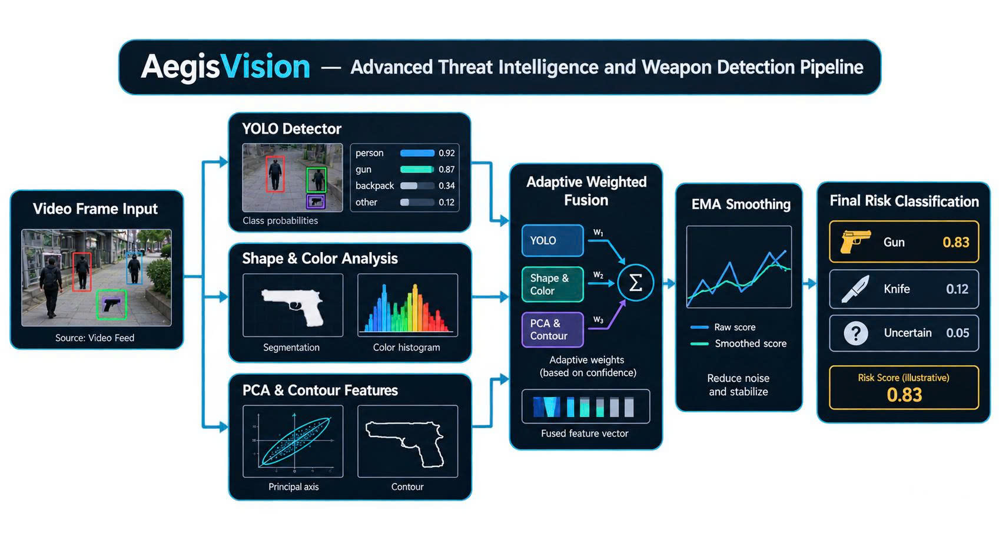
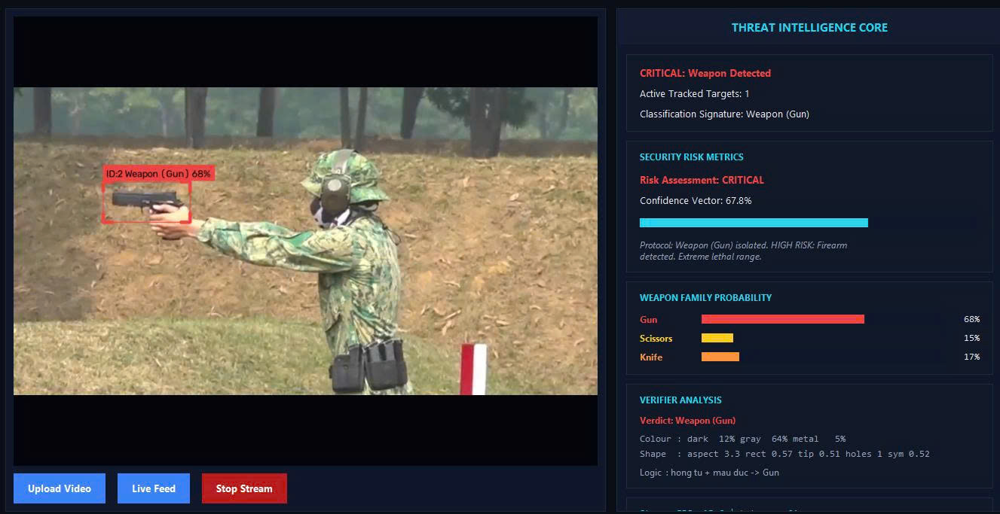
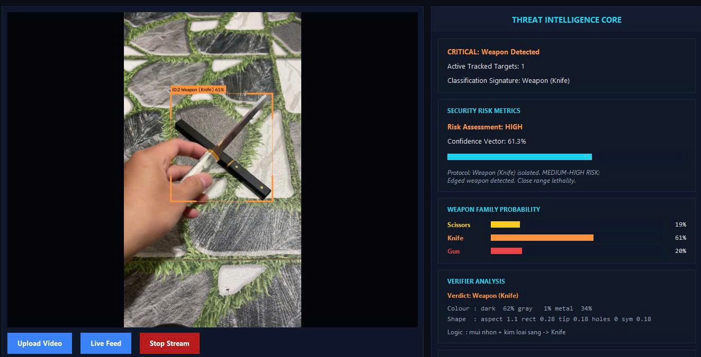
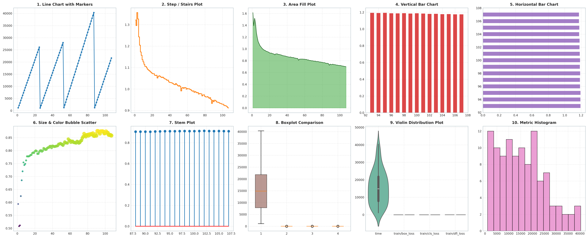
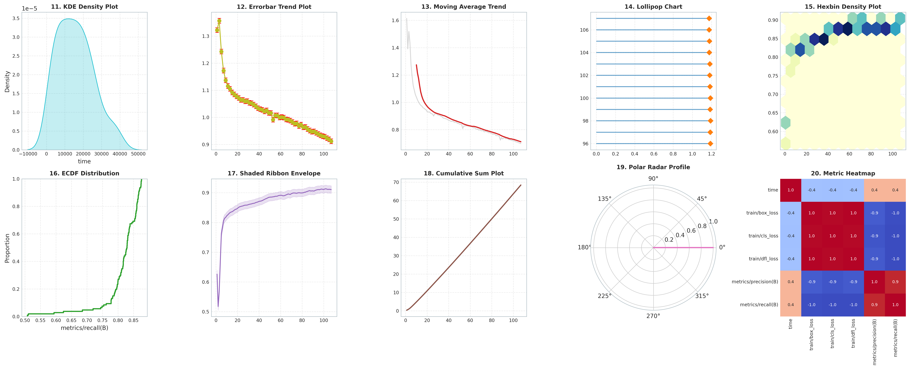
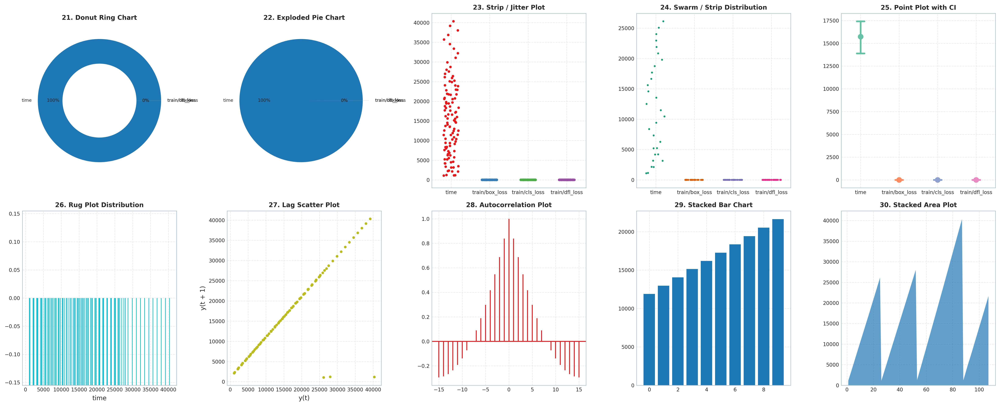
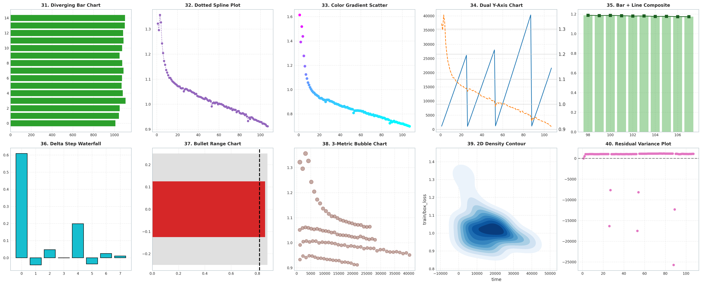
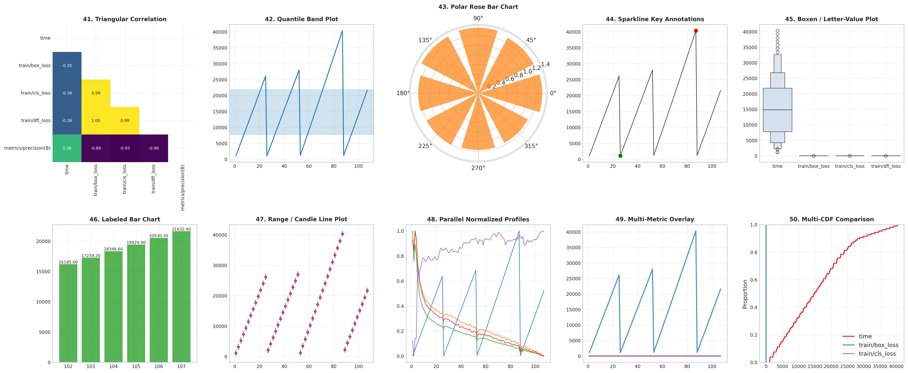

<h2 align="center">
  Author: Huynh Thanh Phong (ReoRioll)
</h2>

<p align="center">
   Computer Science of College of Information and Communication Technology of Can Tho University (Course 48)<br>
</p>

<p>
&nbsp;&nbsp;&nbsp;&nbsp;&nbsp;&nbsp;&nbsp;&nbsp;&nbsp;&nbsp;&nbsp;&nbsp;&nbsp;&nbsp;&nbsp;&nbsp;&nbsp;&nbsp;
<b>Researchs:</b> Artificial Intelligence in Education - Mathematics in Deep Learning and Machine Learning<br>

&nbsp;&nbsp;&nbsp;&nbsp;&nbsp;&nbsp;&nbsp;&nbsp;&nbsp;&nbsp;&nbsp;&nbsp;&nbsp;&nbsp;&nbsp;&nbsp;&nbsp;&nbsp;
<mark><b><b>Name Project:</b></b> </mark> YOLO-WeaponID: Hệ thống giám sát và nhận diện mối đe doạ an ninh thời gian thực<br>

&nbsp;&nbsp;&nbsp;&nbsp;&nbsp;&nbsp;&nbsp;&nbsp;&nbsp;&nbsp;&nbsp;&nbsp;&nbsp;&nbsp;&nbsp;&nbsp;&nbsp;&nbsp;
<mark><b><b>Link Data:</b></b> </mark> https://www.kaggle.com/datasets/reorioll/data-weapon<br>

</p>
<p align="center">
   <b>Presional link Information</b>
</p>

<p>
&nbsp;&nbsp;&nbsp;&nbsp;&nbsp;&nbsp;&nbsp;&nbsp;&nbsp;&nbsp;&nbsp;&nbsp;&nbsp;&nbsp;&nbsp;&nbsp;&nbsp;&nbsp;
Facbook: https://www.facebook.com/huynh.thanh.phong.561667 <br>

&nbsp;&nbsp;&nbsp;&nbsp;&nbsp;&nbsp;&nbsp;&nbsp;&nbsp;&nbsp;&nbsp;&nbsp;&nbsp;&nbsp;&nbsp;&nbsp;&nbsp;&nbsp;
Kaggle: https://www.kaggle.com/reorioll <br>

&nbsp;&nbsp;&nbsp;&nbsp;&nbsp;&nbsp;&nbsp;&nbsp;&nbsp;&nbsp;&nbsp;&nbsp;&nbsp;&nbsp;&nbsp;&nbsp;&nbsp;&nbsp;
Youtobe: https://www.youtube.com/@ReoRioll-2304CICTCTU <br>
</p>
<br>

```python
!git clone https://github.com/huynhthanhphong231004IT/Weapon_Identification_with_YOLO.git
```


<div align="center">
<p align="center">
  
  <br><br>
  <i>Kiến trúc phân loại vũ khí hai nhánh: Kết hợp mô hình phát hiện YOLO, trích xuất đặc trưng hình thái học PCA và dung hợp mượt hóa theo thời gian</i>
</p>
</div>

<div align="center">
  <table>
    <tr>
      <td width="50%"></td>
      <td width="50%"></td>
    </tr>
  </table>
  <p><i>Kết quả nhận diện vũ khí và phân tích chỉ số rủi ro trên giao diện hệ thống giám sát an ninh thông minh.</i></p>
</div>

### Cơ sở lý thuyết thuật toán, cơ sở toán học và phương pháp xác minh đặc trưng hình học - màu sắc kết hợp mô hình học sâu.
---
Hệ thống xác minh và theo dõi mối đe dọa được đề xuất dựa trên kiến trúc kết hợp (hybrid framework), dung hợp mô hình phát hiện học sâu (Deep Learning) với hệ thống xác minh logic mờ và hình học định tính. Cơ sở toán học của các thuật toán cốt lõi được mô tả chi tiết.

### 1. Độ trùng lặp khung bao và ghép nối mục tiêu

Để theo dõi các mục tiêu phát hiện qua các khung hình liên tiếp và thực hiện phân nhóm (clustering), chỉ số Giao trên Hợp (IoU) giữa hai khung bao A và B được tính toán theo công thức 

<p align="center">
  
</p>

<p>
  
</p>

### 2. Hàm thuộc tính Logic mờ dạng hình thang/tam giác

Để đánh giá các đặc trưng hình học biến thiên liên tục mà không gặp phải hiện tượng chia ngưỡng cứng (hard thresholding), hàm thuộc tính dạng tam giác/hình thang f(x; a, b, c, d) được định nghĩa
<p align="center">
  
</p>

<p align="center">
  
</p>

### 3. Trích xuất trục chính bằng phân rã ma trận hiệp biến (PCA)

<p>
Để đo lường độ đối xứng không gian và phân bố chiều rộng của đối tượng, các đường biên tiền cảnh thu được sau phân đoạn được chuyển về hệ tọa độ chuẩn hóa thông qua Phân tích Thành phần Chính (PCA). Cho tập hợp  điểm ảnh tiền cảnh đã trừ đi trọng tâm 
</p>


<p align="center">
  
</p>

<p>
  Trục hướng chính của vật thể được xác định bằng cách giải phương trình đặc trưng tìm giá trị riêng  và vecto riêng :
</p>

<p align="center">
  
</p>
<p>
  Các tọa độ không gian khi chiếu lên vecto riêng chính  thể hiện chiều dài dọc của đối tượng. Từ đó, thuật toán chia trục thành  khoảng (bins) để lấy mẫu chiều rộng , phục vụ việc đánh giá độ bất đối xứng  và độ nhọn của vật thể:
</p>

<p align="center">
  
</p>

<p align="center">
  
</p>

### 4. Kết hợp quyết định thích ứng và làm mượt theo thời gian
<p>
  Thay vì chỉ dựa vào xác suất đầu ra (logits) của mạng nơ-ron sâu, vecto phân loại cuối cùng  thực hiện kết hợp vecto xác suất  từ mô hình YOLO với vecto điểm hình học  theo trọng số chất lượng phân đoạn :
</p>


<p align="center">
  
</p>

<p align="center">
  
</p>

<p>
  Trong đó  là độ tin cậy của mô hình phát hiện và  là điểm chất lượng phân đoạn hình ảnh.
</p>

<p>
  Để loại bỏ hiện tượng nhấp nháy (flickering) và dao động dự đoán giữa các khung hình, trung bình động lũy thừa (EMA) với hệ số làm mượt  được duy trì trên một cửa sổ thời gian cố định :
</p>

<p align="center">
  
</p>


## Kết quả huấn luyện trên mô hình Yolo11n trên tập dữ liệu data-weapon
<div align="center">
<p align="center">
  
  <hr width="100%">
  
  <hr width="100%">
  
  <hr width="100%">
  
  <hr width="100%">
  
  <br><br>
  <i>Khung phân tích đa chiều về động lực học quá trình huấn luyện, phân phối thống kê và tương quan chỉ số đánh giá</i>
</p>
</div>


